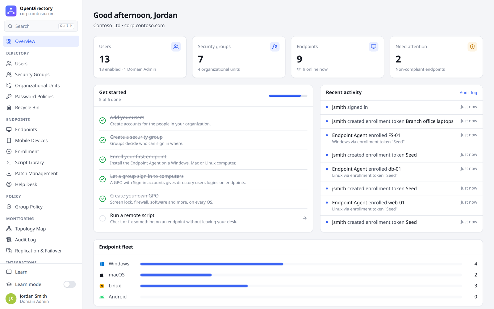
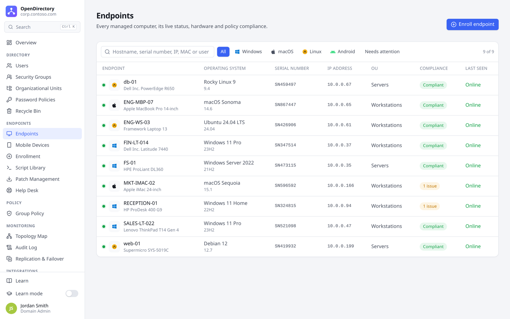
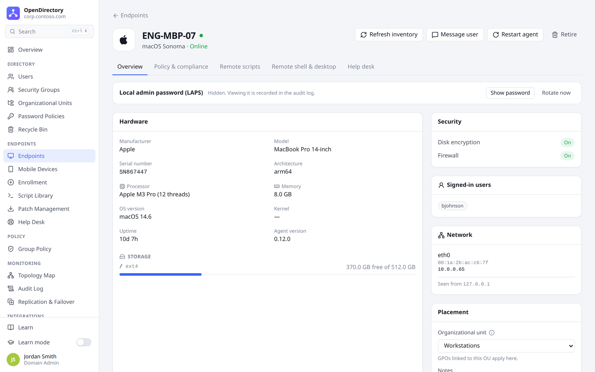
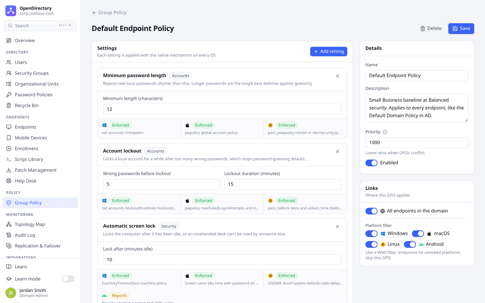
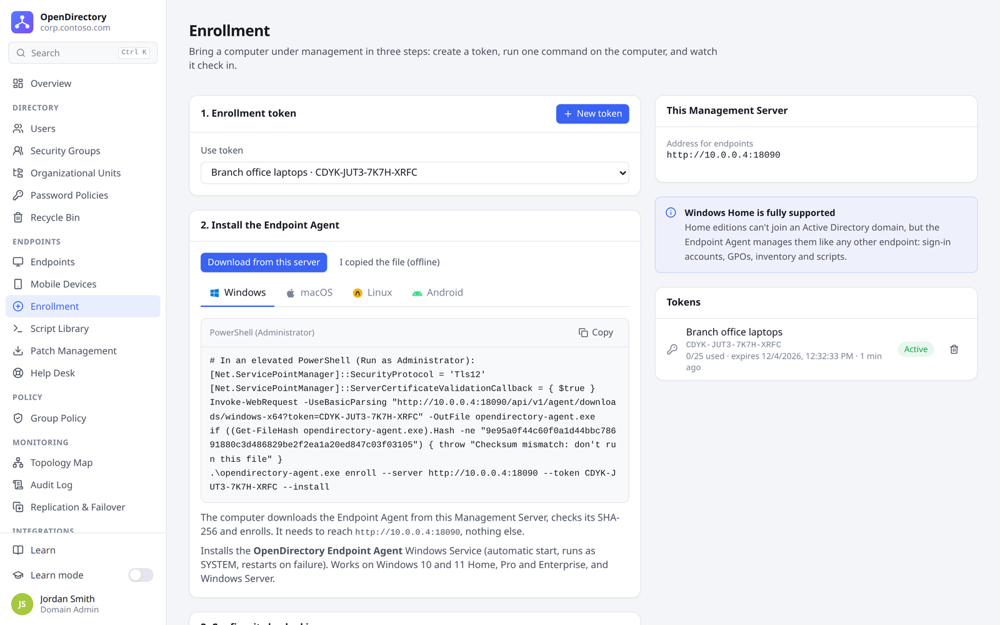
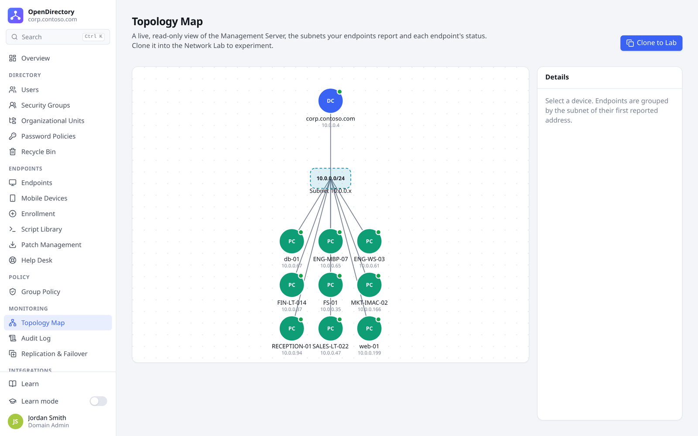
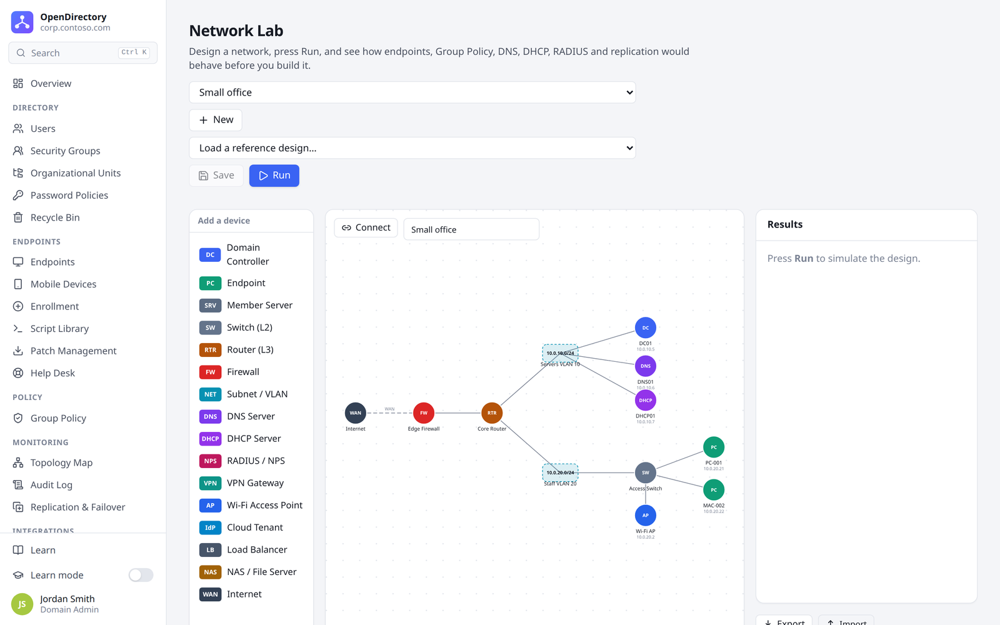
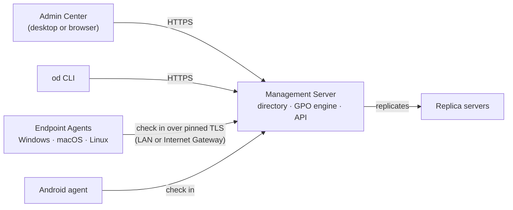

<div align="center">


# OpenDirectory

**Directory services, Group Policy and endpoint management for Windows, macOS, Linux and Android.**<br>
The parts of Windows Server and Active Directory you use every day, in one app that runs anywhere.

[](https://github.com/Lin8x/OpenDirectory/releases/latest) [](https://github.com/Lin8x/OpenDirectory/releases)  

[**Download**](#download) · [Features](#features) · [Quick start](#quick-start) · [How it works](#how-it-works) · [Docs](docs/GUIDE.md) · [Roadmap](docs/ROADMAP.md)

<br>



</div>

<br>

OpenDirectory manages users, security groups, organizational units, Group Policy, scripts, patches and device inventory for a whole fleet from one console. It works on the editions Active Directory can't reach, including **Windows Home** and unactivated Windows, and on **macOS, Linux and Android** too. Run the directory inside the desktop app for a small office or homelab, or on a dedicated Management Server, in Docker, or with replicas for failover.

> **Status:** early but working. Linux is verified end to end. Windows and macOS build in CI on every change and still need more real-hardware testing. See the [roadmap](docs/ROADMAP.md).

## Highlights

<table>
<tr>
<td width="50%" valign="top">

### Directory
Users, security groups and OUs with AD-style naming, fine-grained password policies (PSOs), self-service password change, LAPS and a 180-day Recycle Bin.

</td>
<td width="50%" valign="top">

### Group Policy for every OS
One GPO applies through each platform's native mechanism (`net accounts`, `pwpolicy`, PAM, systemd and more), with OU links, priority, platform filters and RSoP.

</td>
</tr>
<tr>
<td valign="top">

### Endpoint management
Live inventory and compliance, a Script Library with 20 templates, patch management, remote shell, RDP/VNC/SSH tunnels and a help desk chat. No inbound ports needed.

</td>
<td valign="top">

### Network services
Optional DNS, DHCP, an internal certificate authority with auto-enrollment, RADIUS, a read-only LDAP/LDAPS server and an experimental Samba AD domain controller.

</td>
</tr>
<tr>
<td valign="top">

### Built for operations
Security baselines on day one, encrypted scheduled backups to 10+ destinations, replica servers with failover, agents that update themselves in rollout rings, and a full audit log.

</td>
<td valign="top">

### Approachable
Learn mode explains every term next to its Active Directory equivalent, a Network Lab simulates designs before you build them, and a Classic layout feels like ADUC and GPMC.

</td>
</tr>
</table>

## Screenshots

<table>
<tr>
<td width="50%"><br><sub><b>Endpoints.</b> Every managed computer with its live status and compliance.</sub></td>
<td width="50%"><br><sub><b>Endpoint detail.</b> Hardware, security, LAPS, remote shell and help desk.</sub></td>
</tr>
<tr>
<td><br><sub><b>Group Policy.</b> Each setting shows how it's enforced on every OS.</sub></td>
<td><br><sub><b>Enrollment.</b> One command downloads the agent from your server and enrolls.</sub></td>
</tr>
<tr>
<td><br><sub><b>Topology Map.</b> A live view of servers, subnets and endpoints.</sub></td>
<td><br><sub><b>Network Lab.</b> Design a network and simulate it before you build it.</sub></td>
</tr>
</table>

## Download

Install the **Admin Center**, the desktop app you manage everything from. Every button downloads the latest release from GitHub, and the app updates itself after that (system packages update through your package manager). Check files against [`SHA256SUMS`](https://github.com/Lin8x/OpenDirectory/releases/latest/download/SHA256SUMS). Installers aren't code-signed yet, so Windows SmartScreen asks you to confirm (**More info** > **Run anyway**), and on macOS you right-click the app and choose **Open** the first time.

### Windows

<p>
<a href="https://github.com/Lin8x/OpenDirectory/releases/latest/download/OpenDirectory-AdminCenter-windows-x64-setup.exe"></a>
<a href="https://github.com/Lin8x/OpenDirectory/releases/latest/download/OpenDirectory-AdminCenter-windows-x64.msi"></a>
</p>

One-line install (PowerShell, as your usual user):

```powershell
irm https://github.com/Lin8x/OpenDirectory/releases/latest/download/install.ps1 | iex
```

Windows 10 and 11, x64. Choose the `.msi` for Group Policy Software Installation, Intune or ConfigMgr, and the `.exe` for a single PC.

### macOS

<p>
<a href="https://github.com/Lin8x/OpenDirectory/releases/latest/download/OpenDirectory-AdminCenter-macos-universal.dmg"></a>
</p>

One-line install:

```bash
curl -fsSL https://github.com/Lin8x/OpenDirectory/releases/latest/download/install.sh | sh
```

Homebrew:

```bash
brew install --cask lin8x/opendirectory/opendirectory-admin-center
```

Universal build for Apple silicon and Intel Macs.

### Linux

<p>
<a href="https://github.com/Lin8x/OpenDirectory/releases/latest/download/OpenDirectory-AdminCenter-linux-amd64.deb"></a>
<a href="https://github.com/Lin8x/OpenDirectory/releases/latest/download/OpenDirectory-AdminCenter-linux-x86_64.rpm"></a>
<a href="https://github.com/Lin8x/OpenDirectory/releases/latest/download/OpenDirectory-AdminCenter-linux-x86_64.pkg.tar.zst"></a>
<a href="https://github.com/Lin8x/OpenDirectory/releases/latest/download/OpenDirectory-AdminCenter-linux-x86_64.AppImage"></a>
<a href="https://github.com/Lin8x/OpenDirectory/releases/latest/download/OpenDirectory-AdminCenter-linux-x86_64.flatpak"></a>
<a href="https://github.com/Lin8x/OpenDirectory/releases/latest/download/OpenDirectory-AdminCenter-linux-amd64.snap"></a>
</p>

One-line install. It picks the `.deb`, `.rpm`, Arch package or AppImage for your distribution, and on apt, dnf and zypper systems it adds the OpenDirectory repository so updates arrive with your other updates:

```bash
curl -fsSL https://github.com/Lin8x/OpenDirectory/releases/latest/download/install.sh | sh
```

Or use your package manager.

Debian, Ubuntu, Linux Mint, Pop!_OS (APT):

```bash
curl -fsSL https://lin8x.github.io/OpenDirectory/opendirectory.gpg | sudo tee /usr/share/keyrings/opendirectory.gpg >/dev/null
echo "deb [signed-by=/usr/share/keyrings/opendirectory.gpg] https://lin8x.github.io/OpenDirectory/apt ./" | sudo tee /etc/apt/sources.list.d/opendirectory.list
sudo apt update && sudo apt install open-directory-admin-center
```

Fedora, RHEL, Rocky Linux, AlmaLinux (DNF):

```bash
sudo curl -fsSL -o /etc/yum.repos.d/opendirectory.repo https://lin8x.github.io/OpenDirectory/opendirectory.repo
sudo dnf install open-directory-admin-center
```

openSUSE (Zypper):

```bash
sudo zypper addrepo --refresh https://lin8x.github.io/OpenDirectory/opendirectory.repo
sudo zypper install open-directory-admin-center
```

| Distribution | Install |
| --- | --- |
| Arch, Manjaro, EndeavourOS | `yay -S opendirectory-admin-center-bin` (AUR), or `sudo pacman -U` the `.pkg.tar.zst` above |
| Any (Flatpak) | `flatpak install flathub io.github.lin8x.OpenDirectory`, or `flatpak install --user` the `.flatpak` above |
| Any (Snap) | `sudo snap install opendirectory-admin-center`, or `sudo snap install --dangerous` the `.snap` above |
| NixOS and Nix | `nix profile install 'github:Lin8x/OpenDirectory?dir=packaging/nix'` |

x86_64 only. Alpine isn't supported natively (the app needs glibc); use the Flatpak there. The Flathub, Snap Store and AUR listings and the APT/DNF repository go live as each one is published; until then, use the buttons above.

### Endpoint Agent, Management Server and CLI

You don't download the Endpoint Agent by hand: **Admin Center > Enrollment** shows the one command to run on each computer. To roll it out to a whole fleet, every release also has agent packages for your deployment tool:

| OS | Package | Unattended install |
| --- | --- | --- |
| Windows | `OpenDirectory-Agent-windows-x64.msi` | `msiexec /i OpenDirectory-Agent-windows-x64.msi /qn SERVER=https://dc01.example.com:8443 TOKEN=<token> FINGERPRINT=<sha256>` (Group Policy, Intune, ConfigMgr, RMM) |
| macOS | `OpenDirectory-Agent-macos-universal.pkg` | Stage `/Library/Application Support/OpenDirectory/enroll.conf` with `SERVER=`, `TOKEN=` and `FINGERPRINT=` lines, then install the package with your MDM |
| Linux | `opendirectory-agent-linux-amd64.deb`, `-x86_64.rpm`, `-x86_64.pkg.tar.zst` | Stage `/etc/opendirectory/enroll.conf` the same way, then install the package (Ansible, Puppet, Salt, kickstart) |

The **Management Server** and the **od CLI** are in the Admin Center already. For a dedicated server, use the [Docker image](docs/DOCKER.md), the `opendirectory-server` and `opendirectory-cli` Linux packages, or the raw binaries (`opendirectory-server-*`, `od-*`) on the [Releases page](https://github.com/Lin8x/OpenDirectory/releases/latest). Store submission and packaging details are in [packaging/README.md](packaging/README.md).

## Quick start

**1. Install the Admin Center** from [Download](#download) and open it.

**2. Create your domain.** Choose **Host the directory on this computer**. The setup wizard creates the domain and the first Domain Admin, then applies a **security baseline**: Custom, Minimal, Home/Homelab, Small Business, Enterprise, Education or High Security. You can layer modifiers on top: security level, patch rings, device ownership, admin model, USB policy, remote access, compliance packs (HIPAA, PCI DSS, SOC 2, CMMC, GDPR, FERPA, CIPA) and rollout. A review screen shows every OU, group and GPO before anything is created. Turn on **Launch at startup** so the directory comes back after a reboot.

**3. Enroll computers.** Open **Enrollment**, create a token, and run the command it shows on each computer as Administrator or root. The command downloads the Endpoint Agent from your Management Server, checks its SHA-256 and installs the background service. Use the [fleet packages](#endpoint-agent-management-server-and-cli) to roll it out through Group Policy, Intune or an MDM.

**4. Let people sign in.** Create users, add them to a security group, then add a **Sign-in accounts** setting to a GPO. The agent creates matching local accounts on each endpoint.

<details>
<summary><b>Headless server (no GUI)</b></summary>

```bash
sudo opendirectory-server install-service     # systemd, launchd or a Windows Service; starts at boot
od init --server https://<host>:8443 --fingerprint <sha256>   # interactive wizard, or pass --baseline, --organization, ... flags
od status
```

`od init --help` lists every flag, so setup can be fully scripted (`OD_PASSWORD` supplies the password). `od init --dry-run` prints the plan without creating anything. For Docker, see [Docker and web mode](#docker-and-web-mode).

</details>

## Features

### Identity and access

- **Password policies:** a Default Domain Password Policy plus fine-grained policies (PSOs) for groups, with history, expiry and lockout. Users change their own password, or redeem a one-time code from the help desk, with **Change password** on any sign-in screen.
- **LAPS:** each endpoint keeps a local administrator account with its own rotating password, stored encrypted on the server. Viewing it is audited.
- **Recycle Bin:** deleted users, groups, OUs, GPOs and scripts come back with their memberships and passwords for 180 days.
- **Domain Controller (experimental):** on a Linux Management Server with Samba installed, OpenDirectory provisions a Samba AD domain controller and keeps it in sync (users, groups and passwords). Windows, macOS and Linux computers can then do a real domain join with Kerberos. It hasn't been tested on real hardware yet, so try it on a test server first.

### Group Policy and scripts

- **GPOs** describe intents such as "lock the screen after 10 minutes", and the Endpoint Agent applies each one with the native mechanism on Windows, macOS, Linux and Android. Link GPOs to the domain or OUs, set priority, filter by platform, and see the resultant set of policy (RSoP) for any endpoint.
- **Script Library:** save scripts with parameters (passed as `OD_PARAM_<NAME>` environment variables, never pasted into the script), start from 20 built-in templates, and run them against any mix of endpoints, security groups and OUs. Attach a script to a GPO to run it **at startup, at sign-in, on a schedule or once**, inherited through OU links like GPO scripts in AD. From the CLI: `od script run "Disk usage report" --ou Servers -p PATH=/var`.

### Endpoints

- **Endpoint Agent:** a headless, low-priority background service (Windows Service, launchd daemon or systemd unit) that checks in every 15 seconds over the LAN or the **Internet Gateway**, which uses device certificates. The **Android agent** checks in about every 15 minutes through the system job scheduler.
- **Patch Management:** pending OS updates on every endpoint, with scan and install for endpoints, groups or OUs.
- **Remote support:** an interactive terminal on any endpoint, RDP, VNC or SSH through an encrypted tunnel, user notifications and a help desk chat. Endpoints never need inbound ports.
- **Agent updates:** agents older than the server download the matching build from the Management Server, check its SHA-256, swap it in and roll back on their own if the new version can't check in. Choose the rollout ring in **Settings > Endpoint Agent updates**: all endpoints, pilot OUs only, or off. Older agents keep working with a newer server.
- **Mobile devices:** track phones and tablets and download Apple configuration profiles for Wi-Fi, passcode rules and your root CA. Over-the-air MDM enrollment isn't supported yet.

### Network services

The Management Server can host the roles a Windows Server usually provides, each off until you turn it on in **Network Services**: a **DNS server** for the domain with records for every endpoint, a **DHCP server**, an internal **certificate authority** (with GPO settings to trust it and auto-enroll machine certificates), a **RADIUS server** for VPNs and network devices (PAP and MS-CHAPv2), and a read-only **LDAP/LDAPS server** with an AD-style schema.

### Availability and recovery

- **Replication and failover:** add read-only **replica servers** under **Replication & Failover**. Each copies the whole directory every minute and serves agents, sign-in, DNS, RADIUS and LDAP. Agents learn every server and fail over automatically. If the primary is lost, **promote** a replica.
- **Backup & Restore:** one `.odbackup` file holds the whole configuration, encrypted with a passphrase (Argon2id + XChaCha20-Poly1305). Plans run hourly, daily or weekly with retention, to a local folder or SMB/NFS share, SFTP, FTPS/FTP, WebDAV, S3-compatible storage, any HTTPS endpoint, Google Drive, OneDrive or Dropbox. Restores are verified first and keep the old data in a `pre-restore` folder.

<details>
<summary><b>Sign-in and break-glass recovery</b></summary>

The Admin Center always asks Domain Admins to sign in, because it can run scripts, open remote shells and change Group Policy on every enrolled endpoint. The first Domain Admin is the account you create in the setup wizard; there is no default or generated password.

If every Domain Admin is locked out and the directory is hosted in the Admin Center on this computer, click **Forgot password?** on the sign-in screen. Your operating system asks for an administrator password in its own prompt (polkit on Linux, UAC on Windows, the macOS authorization dialog), so OpenDirectory never sees it. Then you pick the Domain Admin and set a new password.

On a standalone Management Server, recover from the console of the server host. These commands read the directory on disk, need root (Administrator on Windows) or the account that owns the data directory, have no network API, and write a `user.password_reset.break_glass` entry to the audit log:

```bash
sudo opendirectory-server admin list
sudo opendirectory-server admin reset-password <user>             # prompts for the new password
sudo opendirectory-server admin reset-password <user> --generate  # prints a random temporary password
```

The reset follows the password policy, signs out the account's existing sessions and, with `--enable`, re-enables a disabled account. The default data directory is `/var/lib/opendirectory` (`C:\ProgramData\OpenDirectory\server` on Windows). For the Admin Center's built-in server, pass `--data-dir ~/.local/share/dev.opendirectory.admincenter/server` (`%APPDATA%\dev.opendirectory.admincenter\server` on Windows, `~/Library/Application Support/dev.opendirectory.admincenter/server` on macOS).

</details>

<details>
<summary><b>Reset settings and factory reset</b></summary>

**Settings → Reset** has two options. Both ask for your password again and for the domain name typed out, and both are written to the audit log first.

- **Reset settings to defaults** restores server settings (Default Domain Password Policy, branding, retention, naming convention, agent update rollout, DNS/DHCP/RADIUS/LDAP settings, backup plans, integrations) and, optionally, the Admin Center's own preferences. Users, groups, OUs, computers, GPOs, scripts and certificates are kept.
- **Factory reset** erases the whole data directory (directory, GPOs, enrolled endpoints, keys, certificates and the audit log) and opens the setup wizard. It offers a backup first. In the Admin Center hosting the directory, your operating system asks for an administrator password before anything is erased. A standalone server is reset on its host: stop the service, then run `sudo opendirectory-server factory-reset`. The new directory's first audit log entry records the reset.

</details>

### Docker and web mode

The Management Server can serve the Admin Center to any browser (`--web-ui <folder>`, or a `web` folder next to the binary). The Docker image does this out of the box:

```bash
docker compose up -d     # builds the image from this repository and starts it on port 8443
```

The included [`docker-compose.yml`](docker-compose.yml) also works as a Portainer stack. See [docs/DOCKER.md](docs/DOCKER.md).

## How it works



| Component | Binary | What it is |
| --- | --- | --- |
| Admin Center | `opendirectory-admin-center` | Native desktop app (Tauri). Hosts the Management Server in-process, or connects to a remote one. A tray icon keeps it running. |
| Management Server | `opendirectory-server` | Directory database (SQLite), Group Policy engine and REST API over TLS. Same code as the embedded server. |
| Endpoint Agent | `opendirectory-agent` | Low-priority background service that applies GPOs, runs jobs and reports inventory and compliance. |
| Android agent | `apps/android-agent` | 48 KB Android app with inventory, security status, the managed-device notice and help desk chat. |
| CLI | `od` | Everything the Admin Center does, scriptable, with `od explain <term>` for newcomers. |

Agents always connect out to the Management Server and pin its certificate fingerprint, so endpoints never need inbound ports. Read [docs/ARCHITECTURE.md](docs/ARCHITECTURE.md) for the details.

### Repository layout

```
crates/od-core     shared model, Group Policy engine (RSoP), agent protocol
crates/od-client   HTTPS client with certificate pinning
crates/od-server   Management Server (axum + SQLite)
crates/od-agent    Endpoint Agent
crates/od-cli      `od`
apps/admin-center  Admin Center (React + Tauri)
apps/android-agent Android Endpoint Agent (Kotlin, no AndroidX)
packaging/         installers, store manifests and install scripts
docs/              guide, architecture, roadmap and screenshots
```

## Development

New to Rust, Cargo or Tauri? Start with [docs/GUIDE.md](docs/GUIDE.md), a plain-language tour of the whole project.

Every developer task has a script in `scripts/`: `.sh` for Linux and macOS, `.ps1` for Windows. They all hand off to `xtask/`, a small Rust program, so each task behaves the same on every OS. If Rust isn't installed yet, the scripts tell you how to install it.

```bash
./scripts/setup.sh        # first time: UI deps, rustfmt/clippy, git hooks, then doctor
./scripts/doctor.sh       # check your toolchain and environment, with a fix for anything missing
./scripts/dev.sh          # Admin Center with hot reload
./scripts/dev.sh --browser   # dev Management Server + UI in your browser
./scripts/test.sh         # Rust tests + UI typecheck
./scripts/lint.sh         # rustfmt, clippy (warnings are errors), UI typecheck
./scripts/fmt.sh          # format Rust code
./scripts/build.sh --app  # release binaries + the Admin Center installer for this OS
./scripts/clean.sh        # remove build output
./scripts/commit.sh       # guided Conventional Commit
./scripts/x.sh help       # everything else
```

On Windows, run the same names with `.ps1` in PowerShell, for example `.\scripts\dev.ps1 --browser`. If PowerShell refuses to run scripts, allow local scripts once with `Set-ExecutionPolicy -Scope CurrentUser RemoteSigned`.

| Script | Does |
| --- | --- |
| `setup` | First-time setup: UI dependencies, Rust components, git hooks, then `doctor` |
| `doctor` | Checks Rust, Node, OS packages, git and signing setup, and prints a fix for each problem |
| `dev` | Runs the Admin Center with hot reload (`--browser` for a dev server + browser UI) |
| `build` | Release build of the server, agent and CLI (`--app` adds the Admin Center installer) |
| `test` | Rust tests and the UI typecheck |
| `lint` | Formatting check, clippy and the UI typecheck |
| `check` | `lint` + `test`, exactly what CI runs |
| `fmt` | Formats all Rust code |
| `clean` | Deletes build output (`target/`, UI `dist/`) |
| `commit` | Walks you through a Conventional Commit message |
| `hooks` | Turns on the git hooks in `.githooks/` |
| `version` | Shows the version in every manifest and whether they agree |
| `release` | Cuts a release (see below) |
| `updater-keys` | Generates the in-app update signing key (one time) |
| `updater-secrets` | Uploads that key to GitHub Actions secrets with `gh` |
| `x` | Runs any task by name: `./scripts/x.sh <task>` |

Prefer typing Cargo? `cargo x <task>` does the same thing as `./scripts/<task>.sh`.

### Releasing

```bash
./scripts/release.sh patch --dry-run   # preview the version bump and changelog
./scripts/release.sh patch             # or minor / major / 1.4.0
```

`release` checks you're on an up-to-date `main` with a clean tree, runs lint and tests, bumps the version everywhere, prepends the changelog from Conventional Commits, commits `chore(release): vX.Y.Z`, tags it and pushes. Whenever `main` carries a version that has no GitHub Release yet, `.github/workflows/release.yml` builds installers for every OS and publishes the release. If `main` is protected, use `--no-push`, push the commit to a branch and merge it as a PR: the release is published when it lands.

**In-app updates.** The Admin Center checks the latest GitHub Release when it opens and offers *Update now* or *Remind me later*; admins can turn checks off in Settings. Updates are signed: run `./scripts/updater-secrets.sh` once, with your signing key, to give GitHub Actions the key it signs with.

See [CONTRIBUTING.md](CONTRIBUTING.md) for commit conventions and the git hooks.

Read [docs/GUIDE.md](docs/GUIDE.md) for a beginner-friendly tour, and [docs/ARCHITECTURE.md](docs/ARCHITECTURE.md) for the technical detail.
