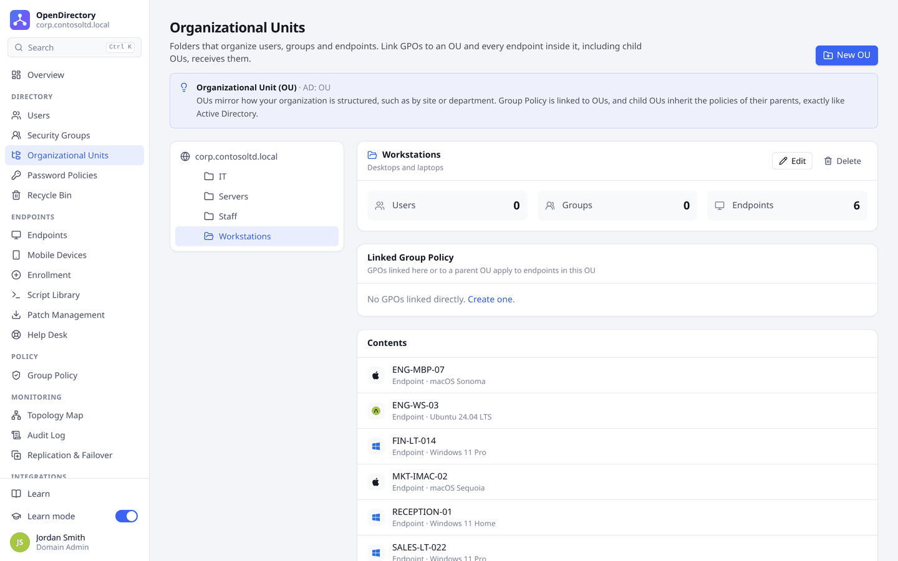
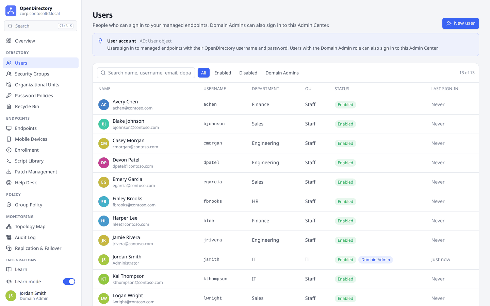
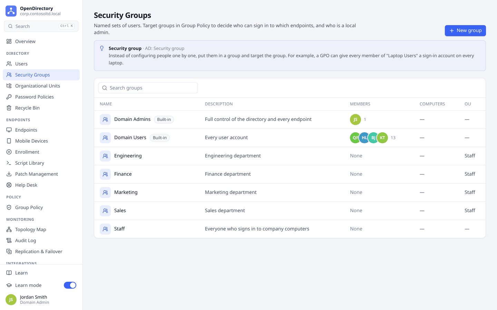

# 2. The directory: domains, OUs, users and groups

[Guide home](README.md) · Previous: [The big picture](01-big-picture.md) · Next: [Group Policy](03-group-policy.md)

A **directory** is a database that describes your organization: who works there, which teams they're in and which computers you own. It's called a directory for the same reason a phone book is: you look things up in it. Everything else in OpenDirectory (policies, sign-in, scripts) reads from the directory, so this is the place to start.

The directory has four building blocks: the **domain**, **organizational units**, **users** and **security groups**.

---

## The domain: the boundary of everything

A **domain** is the name of your whole directory. Everything you manage belongs to exactly one domain. It's written like a web address, for example `corp.contoso.com` or `corp.myhome.local`.

Why a web-address style name? Because later, computers may need to find your server by that name on the network, the same way your browser finds a website. If you own a real domain like `contoso.com`, use a sub-name such as `corp.contoso.com`. If you don't, use one ending in `.local`, which is reserved for private networks. The setup wizard suggests one for you.

People in your directory can write their username in two ways, both meaning the same thing:

- `CORP\alex.morgan` (the short domain name, a backslash, then the username)
- `alex.morgan@corp.contoso.com`

You choose the domain name once, in the setup wizard. Pick something you're happy to keep.

---

## Organizational units (OUs): folders for your stuff

An **organizational unit** (OU, said "oh-you") is a folder inside the domain. You put users, groups and computers into OUs to keep things tidy, exactly like folders on your desktop.

OUs can hold other OUs, so you get a tree:

```
corp.contoso.com            ← the domain (the top of the tree)
├── Staff                   ← people
├── Workstations            ← desktops and laptops
│   ├── Laptops
│   └── Desktops
├── Servers
└── IT
```



*The **Organizational Units** page. The tree is on the left; the right shows what's inside the selected OU and which policies are linked to it.*

### Why OUs matter more than ordinary folders

OUs aren't only for tidiness. They are **where you attach policies**. When you link a policy to the Workstations OU, every computer in Workstations gets it, and so does every computer in Laptops and Desktops below it. This is called **inheritance**: child OUs inherit from their parents, like children inheriting eye color.

So the best way to design your OUs is to ask: *"Which computers should get the same settings?"* Common choices are by device type (Workstations, Servers, Labs), by location (London, New York), or by department. You can always move things later.

**A computer is in exactly one OU.** You pick it when the computer enrolls (chapter 4), and you can move it any time from its page.

---

## Users: one account per person

A **user** (or user account) is one person's identity: their **username**, **password**, full name, email, job title and department. When you create a user, they can sign in to the computers you allow (chapter 3 explains how you allow it).



*The **Users** page.*

A few rules worth knowing:

- **Usernames are 1 to 20 characters**, made of letters, numbers, dots, dashes and underscores, starting with a letter. The limit of 20 exists because Windows can't sign in longer names. `alex.morgan` is a good style.
- **Passwords follow your password policy.** The **Default Domain Password Policy** (under **Password Policies**) sets the minimum length, how often passwords expire and how many wrong attempts lock an account. You can give some groups stricter rules with a *fine-grained password policy*.
- **Disabling is better than deleting.** When someone leaves, disable the account: they can't sign in anywhere, but their account and history are kept. If you do delete someone, they sit in the **Recycle Bin** for 180 days.
- **People can reset their own password** with **Change password** on a sign-in screen, or you can give them a one-time reset code.

### Domain Admins: the people who run OpenDirectory

A **Domain Admin** is a user with full control: they can sign in to the Admin Center, change any setting and run commands on any computer. The account you create in the setup wizard is the first Domain Admin. To make someone else one, switch on **Domain Admin** when you create or edit them.

Keep this list short. Anyone who is a Domain Admin can control every enrolled computer.

---

## Security groups: teams you can point at

A **security group** is a named list of users, like "Sales" or "Laptop Users". Instead of giving permissions to people one at a time, you give them to a group, then add and remove people from the group.

This is the most important habit in directory management. Say Finance needs access to the finance laptops:

- **Without groups:** you add Avery, Harper and Sam to the laptop policy one by one. When Sam leaves and Jo joins, you edit the policy.
- **With groups:** the laptop policy says "members of the **Finance** group". When Sam leaves and Jo joins, you change the group. The policy never changes.



*The **Security Groups** page.*

Two groups are built in and always exist:

| Group | Who's in it | Used for |
| --- | --- | --- |
| **Domain Admins** | People who run OpenDirectory | Signing in to the Admin Center and the `od` command |
| **Domain Users** | Every user, automatically | Targeting "everyone" |

A user can be in as many groups as you like.

### Groups versus OUs: what's the difference?

This confuses everyone at first, so here's the short rule:

- An **OU** is *where something lives*. Each user or computer is in exactly one OU. You link **policies** to OUs to decide which **computers** get which settings.
- A **group** is *a list of who belongs*. A user can be in many groups. You use groups inside policies to decide which **people** get something, such as an account on a computer.

A practical example: the Finance laptops live in the **Workstations** OU, so they get the workstation security settings. The people allowed to sign in to them are the **Finance** group.

---

> **In Active Directory terms**
>
> Everything in this chapter uses the same names and works the same way as in Active Directory:
>
> | OpenDirectory | Active Directory |
> | --- | --- |
> | Domain | AD domain (forests and trees aren't used; there's one domain) |
> | Organizational unit | OU |
> | User | User object |
> | Security group | Security group (global scope) |
> | Domain Admins / Domain Users | The built-in groups of the same name |
> | Default Domain Password Policy | Default Domain Policy's password and lockout settings |
> | Fine-grained password policy | Password Settings Object (PSO) |
> | Recycle Bin | AD Recycle Bin |
>
> The main difference is where users sign in. In AD, a computer must *join the domain* before directory users can sign in to it. OpenDirectory instead creates a matching local account on each computer, which works even on editions like Windows Home that can't join a domain. Chapter 4 explains this.
