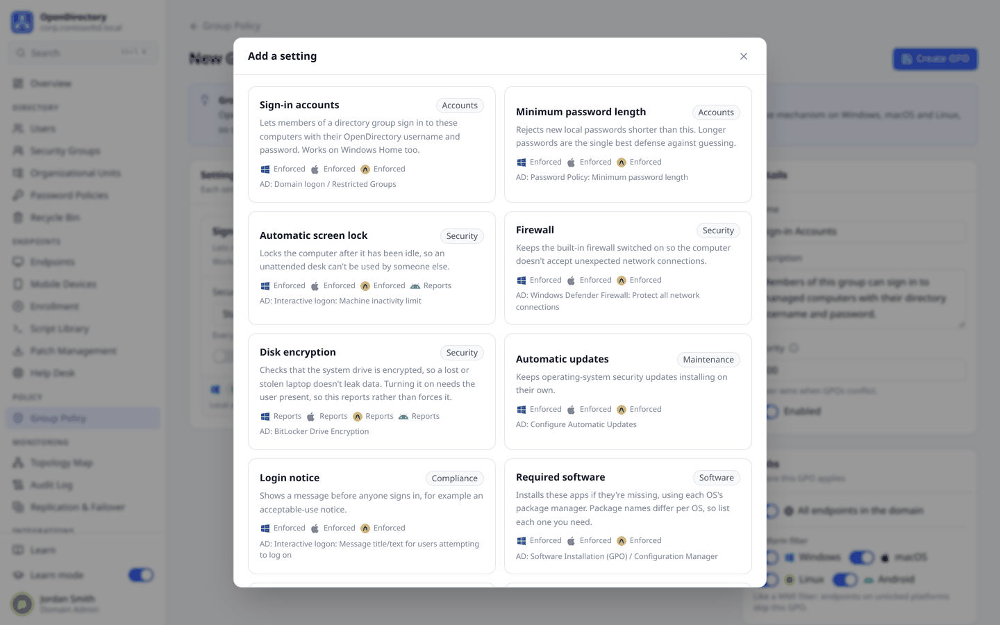
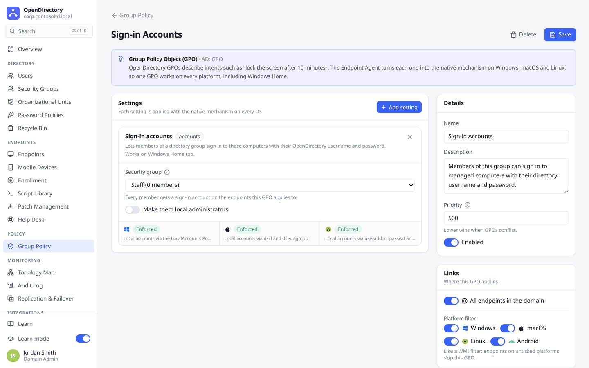
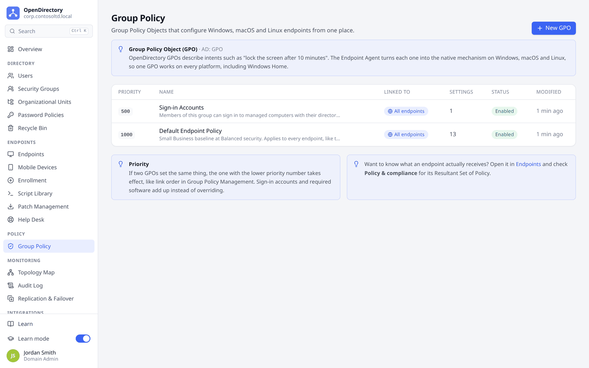
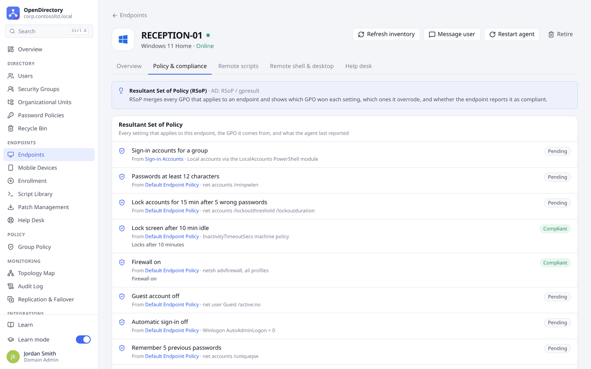

# 3. Group Policy: settings for many computers at once

[Guide home](README.md) · Previous: [The directory](02-directory.md) · Next: [Endpoints and agents](04-endpoints-and-agents.md)

The directory describes *who and what* you have. **Group Policy** describes *how those computers should behave*. It's the feature that saves you from walking to every machine to change a setting.

---

## What a GPO is

A **Group Policy Object** (GPO, said "gee-pee-oh") is a named bundle of settings. For example, a GPO called "Workstation security" might contain:

- Lock the screen after 10 minutes of no use
- Passwords must be at least 12 characters
- Turn the firewall on
- Install operating system updates automatically



*Adding a setting to a GPO. Each card shows the category, what it does, and how well each operating system supports it.*

Each setting describes **what you want**, not how to do it. "Lock the screen after 10 minutes" is the same request whether the computer runs Windows, macOS or Linux. The agent on each computer translates it into that system's own method: a registry setting on Windows, a system preference on a Mac, a desktop setting on Linux. That's why one GPO can cover a whole mixed fleet.

The GPO editor shows exactly how each setting is applied on every operating system, and labels each one:

- **Enforced:** the agent sets it and keeps it set.
- **Report only:** the agent can check it and tell you, but can't change it on that system (for example, it reports whether a disk is encrypted rather than encrypting it for you).
- **Unsupported:** that system has no equivalent. The setting is skipped there.



*The GPO editor. Settings are on the left; on the right are the GPO's name, its **priority** and its **links**.*

---

## Linking: deciding where a GPO applies

A GPO on its own does nothing. It needs a **link**, which says where it applies. In the **Links** card you can:

- Tick **All endpoints in the domain** to apply it everywhere.
- **Link** it to one or more **OUs**. Every computer in those OUs, and in OUs below them, gets it.
- **Add individual endpoints** for one-off cases.
- Use the **Platform filter** to skip some operating systems. For example, untick Linux if a GPO only makes sense on Windows and Macs.

A GPO with no links shows a warning: "Not linked to any OU yet, so it applies nowhere."

### Inheritance, in one picture

```
corp.contoso.com          ← "Default Endpoint Policy" linked here (everyone gets it)
└── Workstations          ← "Workstation security" linked here
    └── Laptops           ← "Laptop power settings" linked here
```

A laptop in the Laptops OU gets **all three** GPOs. A desktop in Workstations gets the first two. A server elsewhere gets only the first.

---

## Priority: what happens when GPOs disagree

Sometimes two GPOs set the same thing differently. Maybe the Default policy says "lock after 15 minutes" and the Workstation policy says "lock after 10". The computer can only do one.

Every GPO has a **priority** number. **The lower number wins.** A GPO with priority 100 beats one with priority 500. Think of it as a ranking: number 1 is first place.



*The **Group Policy** page lists every GPO with its priority. Here "Sign-in Accounts" (500) would beat "Default Endpoint Policy" (1000) if they ever set the same thing.*

A few settings **add up** instead of competing. If two GPOs each give a different group sign-in accounts, both groups get accounts. The same goes for lists of required software.

---

## RSoP: "what does this computer actually get?"

With several GPOs, OUs and priorities in play, it can be hard to work out what a particular computer will end up with. OpenDirectory works it out for you. The answer is called the **Resultant Set of Policy** (RSoP): the final list of settings for one computer, after inheritance and priority.

Open any endpoint and choose the **Policy & compliance** tab. For every setting you'll see which GPO it came from and, for settings that lost a priority contest, which GPO overrode them.



*An endpoint's resultant set of policy. Each line says where the setting came from and whether the computer has applied it.*

---

## Compliance: did it work?

After the agent applies its settings, it reports back on each one. This is **compliance**: whether the computer matches what you asked for. Each setting shows one of these:

| State | Meaning |
| --- | --- |
| **Compliant** | It was already set correctly. |
| **Applied** | It wasn't, and the agent just fixed it. |
| **Non-compliant** | It isn't correct and needs your attention (for example, the disk isn't encrypted). |
| **Failed** | The agent tried and got an error. The message says why. |
| **Unsupported** | This operating system has no equivalent. |
| **Pending** | The agent hasn't reported on it yet. |

The **Overview** page counts endpoints that **need attention**, so you don't have to check each one.

---

## The most useful setting: sign-in accounts

One setting deserves special mention because it connects everything in chapters 2 and 3: **Sign-in accounts**.

You pick a security group. Every member of that group gets a real account on every computer the GPO applies to, with their directory username and password. When you disable a user, their account is disabled on every computer. When they change their password, it changes everywhere. You can also tick **Make them local administrators** to give that group admin rights on those computers.

So "who can sign in to the finance laptops?" becomes: a GPO with a **Sign-in accounts** setting for the **Finance** group, linked to the OU the finance laptops live in.

---

## Scripts in GPOs

A GPO can also run a script from the **Script Library**: at startup, when someone signs in, on a schedule, or once. Like other settings, it follows the GPO's links, so a script attached to the Servers OU runs on every server. Chapter 9 covers scripts.

---

> **In Active Directory terms**
>
> | OpenDirectory | Active Directory |
> | --- | --- |
> | Group Policy Object (GPO) | GPO |
> | Link to an OU, or All endpoints | GPO link to an OU, or to the domain |
> | Priority (lower wins) | Link order / precedence |
> | Platform filter | WMI filter |
> | Individual endpoints | Security filtering on computer objects |
> | Resultant Set of Policy | RSoP / `gpresult` |
> | Sign-in accounts | Restricted Groups plus "Allow log on locally" |
> | GPO scripts (startup, sign-in, scheduled) | Startup/logon scripts and Scheduled Tasks preferences |
>
> The big difference: an AD GPO is a pile of Windows registry and file settings, so it only works on Windows. An OpenDirectory GPO stores intentions that each platform's agent turns into native settings, so the same GPO works on Windows (including Home), macOS, Linux and Android. Each setting in the editor names its closest AD equivalent so you can look it up.
