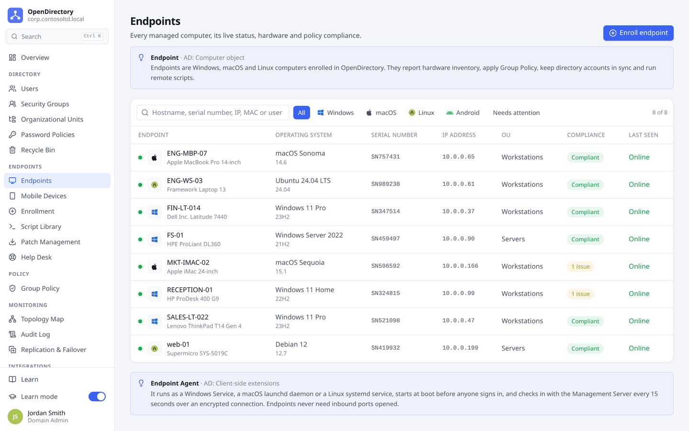
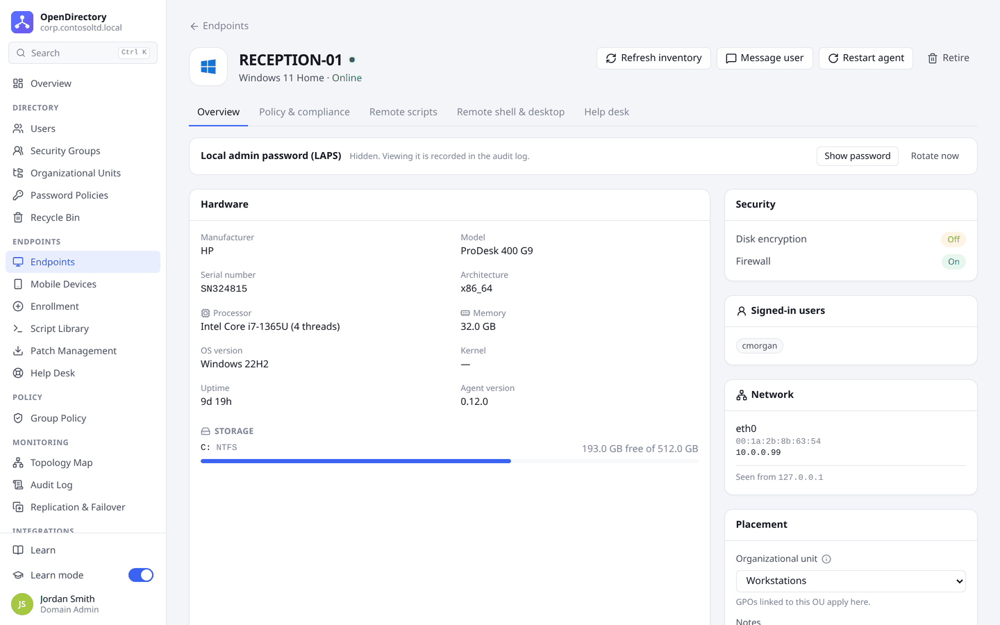
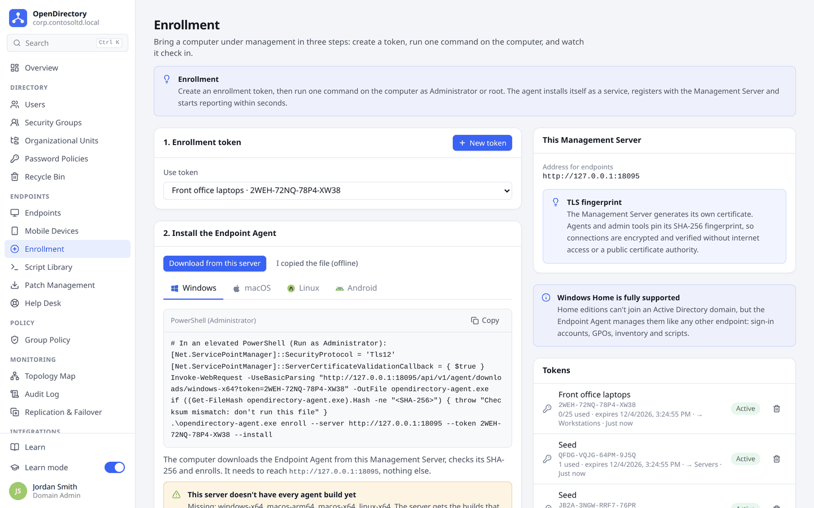

# 4. Endpoints, agents and enrollment

[Guide home](README.md) · Previous: [Group Policy](03-group-policy.md) · Next: [The Internet Gateway and updates](05-gateway-and-updates.md)

So far everything has lived on the Management Server. This chapter is about the other end: the computers themselves, and how they join.

---

## Endpoints

An **endpoint** is any computer or phone that OpenDirectory manages: a Windows laptop, a Mac, a Linux server, an Android phone. The word comes from networking, where it means "a device at the end of a connection", as opposed to the network gear in the middle.

*The **Endpoints** page. Each row is one managed computer.*

For each endpoint, OpenDirectory keeps its **inventory** (manufacturer, model, serial number, processor, memory, disks, network addresses, operating system version, who's signed in), its **security status** (disk encryption, firewall), its **compliance** and whether it's **online** right now.

*One endpoint's page. The tabs along the top lead to its policy, remote scripts, remote shell and desktop, and help desk chat.*

---

## The Endpoint Agent

The **Endpoint Agent** is the small program that makes a computer an endpoint. It's installed once and then runs in the background all the time, before anyone signs in and after they sign out. People using the computer don't see it.

On each operating system it runs the standard way for background programs:

| Operating system | Runs as | Called |
| --- | --- | --- |
| Windows (10, 11, Home, Pro, Enterprise, Server) | A **Windows Service**, as SYSTEM | OpenDirectory Endpoint Agent |
| macOS | A **launchd daemon**, as root | `dev.opendirectory.agent` |
| Linux | A **systemd service**, as root | `opendirectory-agent.service` |
| Android | An app woken by Android's job scheduler | OpenDirectory Agent |

A *service* (or *daemon*, the Mac and Linux word) is a program that starts when the computer boots and runs without anyone signed in. It runs with full administrator rights because changing things like the firewall needs them. It also runs at low priority, so it never slows down the person using the computer.

### Check-in: the agent's heartbeat

Every **15 seconds** the agent contacts the Management Server. This is called a **check-in**. The agent sends:

- its compliance results from last time,
- its inventory, if anything changed.

The server replies with:

1. the computer's **resultant set of policy** (every setting that applies, from chapter 3),
2. the **sign-in accounts** it should have, with passwords for any that are new or changed,
3. any **jobs** waiting for it, such as a script you asked it to run.

The agent applies all of that, and reports how it went at the next check-in. So when you change a GPO, computers usually pick it up within 15 seconds.

The Android agent checks in about every 15 minutes instead, and only when there's a network and the battery isn't low, to save battery.

If the server can't be reached (the computer is off the network, or the server is restarting), the agent waits a little longer between tries and keeps going. It never gives up.

---

## Enrollment: how a computer joins

**Enrollment** is the one-time process of installing the agent on a computer and introducing it to your Management Server. There are three steps, and the **Enrollment** page walks you through them.

*The **Enrollment** page.*

### Step 1: an enrollment token

An **enrollment token** is a code that says "this computer is allowed to join". Without one, nobody can add a computer to your directory. When you create a token you choose:

- **Description:** a note for yourself, such as "Front office laptops".
- **Place new endpoints in:** the OU computers go into when they enroll with this token. Pick this carefully, because the OU decides which GPOs they get the moment they join.
- **Maximum uses:** how many computers can use it. Leave it empty for unlimited.
- **Expires after:** 1 hour, 1 day, 7 days, 30 days or never.

You can revoke a token at any time. Computers that already enrolled aren't affected: once they've joined, they have their own permanent credential and no longer need the token.

### Step 2: install the agent

Choose the computer's operating system, and the page shows the right instructions. You have three ways to do it:

- **Run one command.** Copy it into an administrator terminal on the computer. It downloads the agent from your Management Server, checks the file wasn't tampered with, and installs it.
- **Hand out an enrollment file.** The server builds a ready-to-run file with everything built in: a `.zip` with a double-click installer for Windows, a `.command` file for macOS, or a `.sh` file for Linux. Copy it to the computer by USB stick, a shared folder or email, and run it.
- **Use a deployment tool.** For many computers at once, each release has standard installer packages (`.msi` for Windows, `.pkg` for macOS, `.deb` and `.rpm` for Linux) that tools like Intune, Group Policy software installation, Jamf or Ansible can push out. The page can generate the `enroll.conf` settings file they need.

You need administrator rights on the computer for any of them, because installing a service needs them.

### Step 3: watch it check in

Within seconds the computer appears under **3. Confirm it checked in**, and in the **Endpoints** list. That's it: it now follows its GPOs.

---

## How the agent knows it's talking to your server

Every connection between the agent and the server is encrypted with **TLS**, the same technology that puts the padlock in your browser's address bar. But TLS has a question to answer: how does the agent know the server on the other end is really *yours*, and not an impostor on the network?

Websites solve this by buying a certificate from a *certificate authority*, a company everyone trusts. You don't need to do that. Instead, your Management Server creates its own certificate when it first starts, and that certificate has a unique **fingerprint**: a long code starting with `sha256:` that's practically impossible to fake.

The fingerprint is built into the enrollment command and files. The agent remembers it (this is called **pinning**) and refuses to talk to any server whose fingerprint doesn't match. It's the same idea as SSH remembering a server the first time you connect. You can see the fingerprint on the Enrollment page and under **Settings**.

When a computer enrolls, it swaps the token for its own **endpoint credential**, a secret only it and the server know. From then on, every check-in proves which computer it is.

---

## Why there's no "domain join"

If you've used Windows at work, you may have heard that computers "join the domain". OpenDirectory deliberately doesn't require that.

Joining an Active Directory domain is a Windows feature, and it's missing from Windows Home. Macs and Linux machines can only do it with extra setup. So instead, the agent:

- **creates real local accounts** on the computer for the users your GPOs allow, with their directory username and password, and keeps them in sync,
- **applies settings through each system's own tools**, which exist on every edition.

The result is that one GPO covers a Windows Home laptop, a Mac and a Linux server the same way. The agent also remembers which accounts it created, and never touches accounts it didn't make, such as the computer owner's existing account.

If you do need a real domain join, for example for Windows Pro machines and software that expects Active Directory, OpenDirectory has an experimental **Domain Controller** role. It's optional and not needed for anything in this guide.

---

## Retiring an endpoint

When a computer is sold, broken or replaced, open its page and click **Retire**. It's removed from the directory, its credential stops working, and (if you use the Internet Gateway) its device certificate is revoked. Settings and accounts already applied stay on the computer, so wipe or reinstall it if it's leaving your organization. To manage it again later, enroll it with a new token.

---

> **In Active Directory terms**
>
> | OpenDirectory | Active Directory / Windows |
> | --- | --- |
> | Endpoint | Computer object |
> | Endpoint Agent | Group Policy client and client-side extensions, plus an RMM agent |
> | Check-in (every 15 seconds) | Group Policy background refresh (every 90 minutes by default) |
> | Enrollment | Domain join |
> | Enrollment token | A pre-staged computer account, or a domain-join account's rights |
> | Endpoint credential | The computer account's machine password |
> | TLS fingerprint pinning | Kerberos trust with the domain controller |
> | Retire | Deleting or disabling the computer object |
