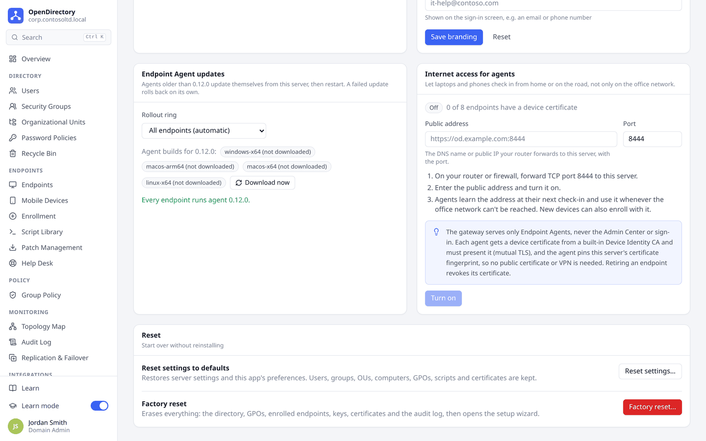

# 5. Working from anywhere: the Internet Gateway and automatic updates

[Guide home](README.md) · Previous: [Endpoints and agents](04-endpoints-and-agents.md) · Next: [The person at the computer](06-end-user-experience.md)

Two things change once your computers are enrolled: laptops leave the office, and new versions of OpenDirectory come out. This chapter covers both.

---

## The problem: laptops go home

Out of the box, your Management Server is reachable on your **office network** (your LAN, short for *local area network*: everything connected to the same router). A laptop that goes home or to a café can't reach it, so it stops checking in. It keeps its last settings, but it won't get new ones, and you can't see it.

The traditional fix is a **VPN** (virtual private network), which makes a remote laptop act as if it's in the office. VPNs work, but they're one more thing to set up, and they only help when the person remembers to connect.

## The Internet Gateway

The **Internet Gateway** is a second door into your Management Server that's safe to open to the internet. It serves **only Endpoint Agents**. The Admin Center, the sign-in page and everything else stay on the office network.

*Settings: **Endpoint Agent updates** on the left, **Internet access for agents** (the Internet Gateway) on the right.*

### How it keeps strangers out

Anyone on the internet can knock on an open door, so the gateway checks *both* sides of every connection. This is called **mutual TLS**:

1. **The agent checks the server**, by its pinned fingerprint, exactly as on the office network (chapter 4).
2. **The server checks the agent.** Each enrolled agent automatically gets a **device certificate**: a digital ID card issued by a small built-in certificate authority called the **Device Identity CA**. The gateway turns away any connection that doesn't present a valid device certificate, before it ever reaches the rest of the server.

You don't manage these certificates. Agents get theirs at their next check-in, and **retiring** an endpoint revokes it immediately. The Settings card shows how many endpoints have one, for example "8 of 8 endpoints have a device certificate".

### Turning it on

1. On your router or firewall, **forward TCP port 8444** to the computer running the Management Server. *Port forwarding* tells your router: "when something from the internet arrives on port 8444, send it to this computer." Your router's admin page has a section for it, often called *Port forwarding*, *Virtual server* or *NAT*.
2. In **Settings > Internet access for agents**, enter the **public address**: the name or public IP address that reaches your router from outside, with the port, such as `https://od.example.com:8444`. If you don't have a domain name, search "what is my IP" from the office to find your public IP. (Many home connections change IP now and then; a free dynamic DNS service gives you a name that follows it.)
3. Click **Turn on**. The status should change to **Listening**.

At their next check-in, every agent learns the public address. From then on, each agent tries the office network first and uses the gateway whenever the office can't be reached. Nobody has to do anything on the laptops.

New computers can also **enroll over the gateway**: the Enrollment page shows a choice between **Office network** and **Internet Gateway** once it's on.

---

## Keeping OpenDirectory up to date

There are two kinds of updates, and both are automatic.

### The Admin Center updates itself

When the Admin Center opens, it checks for a new release. If there is one, it offers **Update now** or **Remind me later**. Updates are digitally signed, and the app refuses any download whose signature doesn't match, so a tampered file can't be installed. You can turn the check off in **Settings > Updates**. Updating the Admin Center also updates the Management Server built into it.

### Agents update themselves

When your Management Server is newer than an agent, the agent updates itself. Here's what happens:

1. At check-in, the server tells the agent which version it should be on.
2. The agent downloads the matching build **from your own Management Server** (not from the internet), and checks its SHA-256 checksum, a fingerprint of the file, to make sure it arrived intact.
3. It swaps the new version in and restarts.
4. If the new version can't check in, the agent **rolls back** to the old version on its own.

The server fetches each platform's agent build once, when it needs it, then keeps it. If your server can't reach the internet, use **Download now** in Settings while it can, or copy the files over yourself.

Older agents keep working with a newer server in the meantime. A setting that needs a newer agent simply waits on older ones.

### Rollout rings: update a few first

Updating every computer at once is risky if a new version has a problem. Professionals use **rollout rings**: a small group gets the update first, and everyone else gets it once that group looks fine. Under **Settings > Endpoint Agent updates**, choose the **Rollout ring**:

| Rollout ring | What happens |
| --- | --- |
| **All endpoints (automatic)** | Every agent updates as soon as the server is newer. This is the default. |
| **Pilot OUs only** | Only endpoints in the OUs you tick (and their child OUs) update. Switch to *All endpoints* when you're happy. |
| **Off (update agents yourself)** | No agent updates itself. |

A good pattern: create a **Pilot** OU, put your own computer and one or two volunteers' in it, and use *Pilot OUs only* for a day or two after each update. The Enterprise baseline creates a Pilot OU for you.

---

> **In Active Directory terms**
>
> | OpenDirectory | Microsoft equivalent |
> | --- | --- |
> | Internet Gateway | Always On VPN, DirectAccess, or the Configuration Manager Cloud Management Gateway |
> | Device Identity CA and device certificates | AD CS computer certificates used for client authentication |
> | Agent self-update | Configuration Manager client upgrades |
> | Rollout rings (pilot OUs) | Deployment rings / pilot collections; Windows Update for Business rings |
