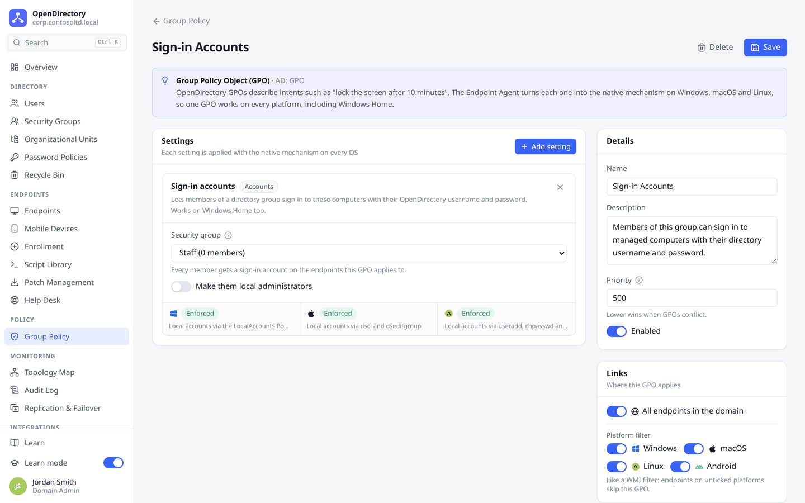
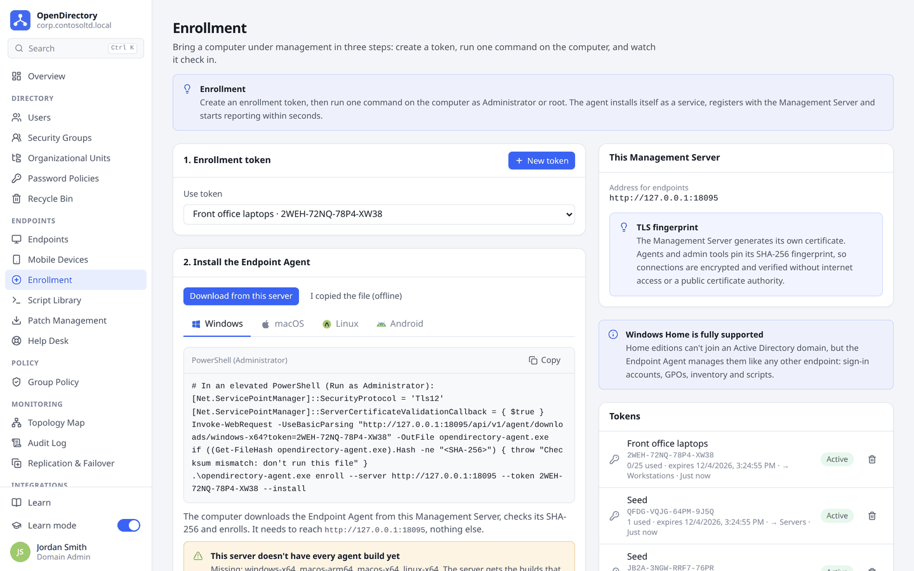
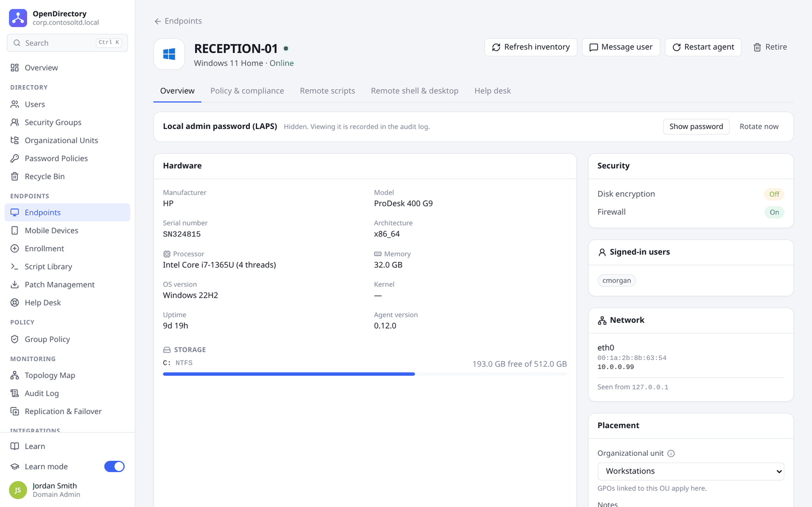
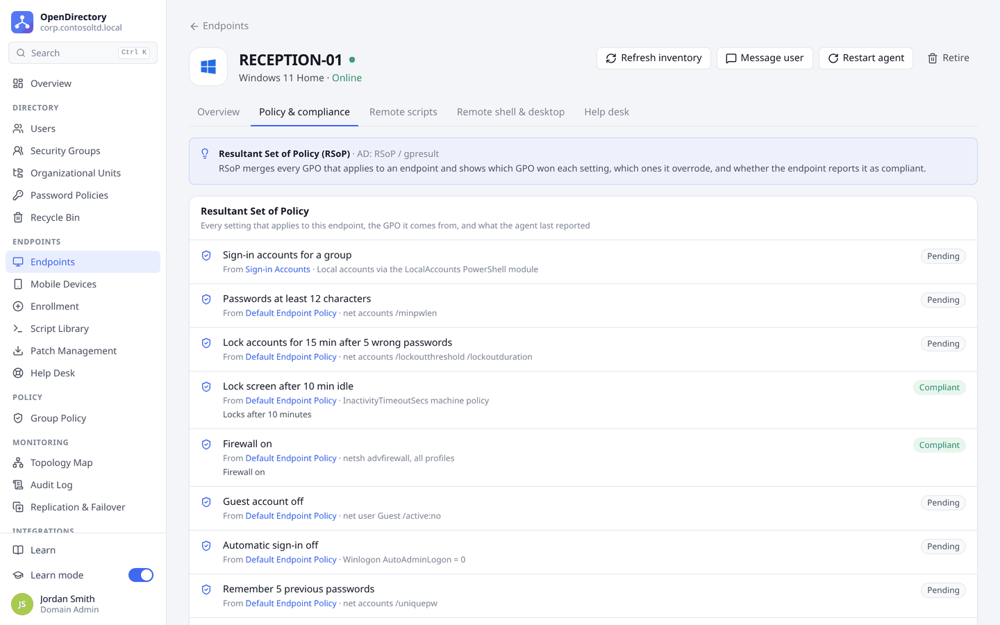
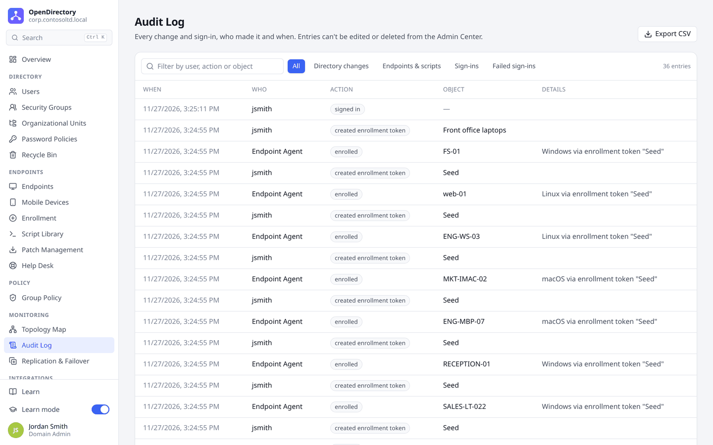

# 8. Walkthrough: enroll and manage your first computer

[Guide home](README.md) · Previous: [Walkthrough: install and create your domain](07-walkthrough-setup.md) · Next: [Everyday tasks](09-everyday-tasks.md)

In this walkthrough you'll create a person, enroll a computer, sign in to it as that person, and then manage it from your desk. It assumes you finished [chapter 7](07-walkthrough-setup.md) with the **Small Business** baseline. If you chose another baseline, the OU and group names differ but every step is the same.

**You'll need:**

- The Admin Center from chapter 7, open and signed in.
- A second computer to manage, on the same network as your Management Server. Any Windows 10 or 11 (Home is fine), Mac or Linux computer works. A virtual machine is perfect for practice.
- Administrator rights on that second computer.

---

## Part A: Create a person

### Step 1: Create a user

1. In the sidebar, click **Users**, then **New user**.
2. Fill in **Full name**, for example *Alex Morgan*. The **Username** fills itself in as `alex.morgan`.
3. Give them an **Initial password** of at least 8 characters.
4. Under **Organizational unit**, choose **Staff**.
5. Under **Security groups**, tick **Staff**. (Every user is also added to Domain Users automatically.)
6. Leave **Domain Admin** off. Alex is a regular user.
7. Click **Create user**.

**Why the Staff group?** The Small Business baseline created a GPO called **Sign-in Accounts** that gives every member of **Staff** an account on every enrolled computer. Putting Alex in Staff is all it takes to let Alex sign in. You can see it under **Group Policy > Sign-in Accounts**.

---

## Part B: Enroll the computer

### Step 2: Create an enrollment token

1. Click **Enrollment** in the sidebar.
2. Click **New token**.
3. **Description:** *My first computer*.
4. **Place new endpoints in:** choose **Workstations**. This decides which GPOs the computer gets as soon as it joins.
5. Leave **Maximum uses** empty and **Expires after** at 7 days.
6. Click **Create token**.

### Step 3: Install the agent on the computer

The Enrollment page now shows install instructions with your token already filled in.

1. Click the tab for the computer's operating system: **Windows**, **macOS**, **Linux** or **Android**.
2. Pick one of the two easy methods:

   **Method 1: copy the command.** Click **Copy** on the command box. Then, on the computer you're enrolling:
   - **Windows:** right-click Start, choose **Terminal (Admin)** or **Windows PowerShell (Admin)**, paste the command and press Enter.
   - **macOS:** open **Terminal** (in Applications > Utilities), paste and press Enter. Type your Mac password when asked.
   - **Linux:** open a terminal, paste and press Enter. Type your password when asked.

   **Method 2: hand out a file.** Under **Or hand out an enrollment file**, click the button for the operating system. Copy the file to the computer (USB stick, shared folder or email) and run it: on Windows, unzip it and double-click the installer; on macOS, double-click the `.command` file; on Linux, run the `.sh` file with `sudo`.

3. Wait a few seconds. You'll see the agent download, check its checksum, enroll and install itself as a service.

### Step 4: Watch it appear

Back in the Admin Center, the **3. Confirm it checked in** card shows the computer's name with a green tick within seconds. Click the name to open its page.

You'll see what the agent reported: the make and model, serial number, operating system, disks, network addresses and security status.

---

## Part C: Sign in as the user

### Step 5: Sign in on the computer

Within about 15 seconds of enrolling, the agent has created Alex's account on the computer.

1. On the managed computer, sign out (or restart).
2. On the normal sign-in screen, choose or type **alex.morgan** and enter the password you set in step 1.
3. Alex is signed in, with a fresh profile, as a regular (non-admin) user.

If you later disable Alex in the Admin Center, the account is disabled on this computer at the next check-in. If Alex changes their password, it changes on every computer.

---

## Part D: Check that policy is working

### Step 6: Read the computer's compliance

1. On the computer's page in the Admin Center, open the **Policy & compliance** tab.
2. Each line is a setting from the **Default Endpoint Policy** or **Sign-in Accounts** GPO. It shows which GPO it came from and its state: **Compliant**, **Applied**, **Non-compliant** and so on.

A **Non-compliant** line usually means something you need to do by hand. For example, "Disk isn't encrypted" means turning on BitLocker (Windows) or FileVault (Mac): OpenDirectory reports encryption but doesn't switch it on for you.

### Step 7: Change a setting and watch it apply

1. Click **Group Policy**, then **Default Endpoint Policy**.
2. Find **Screen lock** and change the minutes, for example to 5.
3. Click **Save**.
4. Go back to the computer's **Policy & compliance** tab. Within about 15 seconds the screen lock line changes to **Applied**, and the computer now locks after 5 minutes.

That's the core loop of OpenDirectory: change a GPO once, and every computer it's linked to follows.

---

## Part E: Be a good neighbor to the user

### Step 8: Add the managed-device notice and help desk

1. In **Group Policy**, open **Default Endpoint Policy** and click **Add setting**.
2. Pick **Managed-device notice** from the *End-user experience* category. Read the default message and adjust it if you like. Leave **Users must acknowledge** on.
3. Click **Add setting** again and pick **Help desk chat**.
4. Click **Save**.

At Alex's next sign-in, a notice explains that the computer is managed, and Alex presses **I understand**. A **Contact IT** shortcut appears in the Start menu (Windows), Applications (Mac) or the app menu (Linux). Chapter 6 explains these settings and the two others in that category.

### Step 9: Answer a help desk message

1. On the managed computer, open **Contact IT** and send a message, such as "Hi, testing".
2. In the Admin Center, click **Help Desk** in the sidebar. The conversation appears. Type a reply and send it.
3. The reply shows up in the chat on the computer.

---

## Part F: Manage it from your desk

### Step 10: Run a script

1. Click **Script Library**, then **Browse templates**.
2. Pick a template that suits the computer's operating system, such as a disk usage report, and click **Use template**.
3. Click **Run…**, choose the computer under **Targets**, and run it.
4. The run appears under the script's history, and on the computer's **Remote scripts** tab, with everything the script printed.

Targets can also be a whole security group or OU, so the same script can run on fifty computers at once.

### Step 11: Open a remote shell

1. On the computer's page, open **Remote shell & desktop**.
2. Click **Open remote shell**.
3. Because the default consent mode is **Ask the user to allow it**, Alex gets a prompt on the computer. Once they click Allow, you have a command window on that computer. If nobody is signed in, it connects straight away (you can change that, see chapter 6).
4. Click **Disconnect** when you're done.

### Step 12: Check the Audit Log

Click **Audit Log** in the sidebar. Every step you just took is recorded: who created the user, the token, the enrollment, the GPO change, the script run and the remote shell session.

---

## You did it

You've done the whole lifecycle: a person, a computer, sign-in, policy, compliance, end-user communication and remote management. Everything else in OpenDirectory builds on these same pieces.

**Next:** [everyday tasks and fixing common problems](09-everyday-tasks.md).
