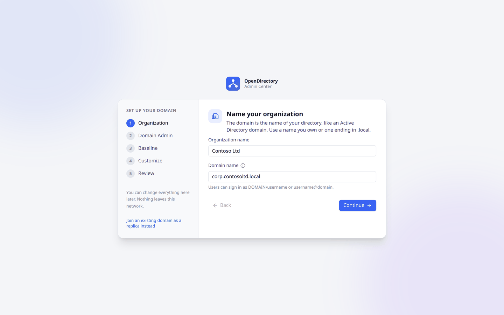
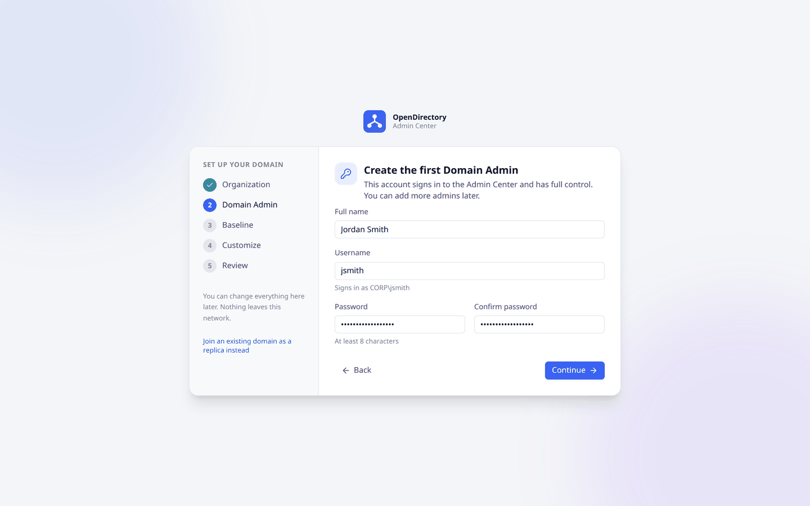
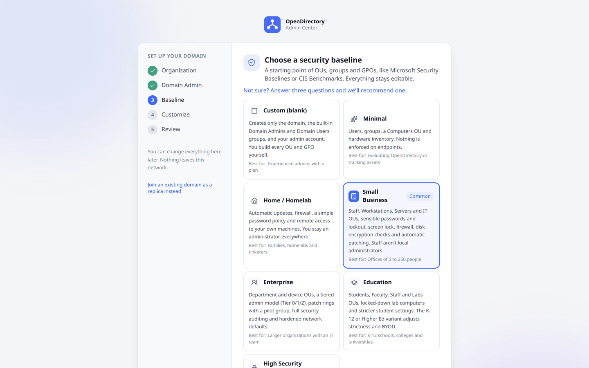
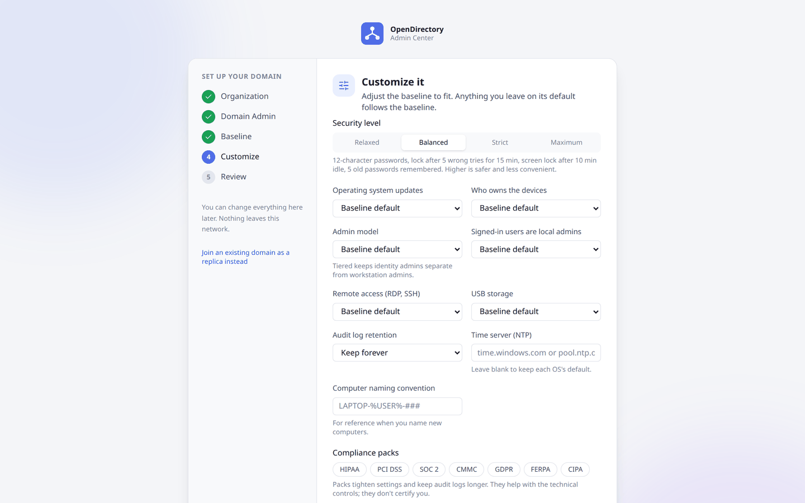
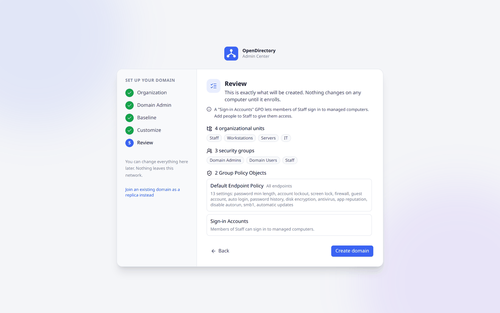
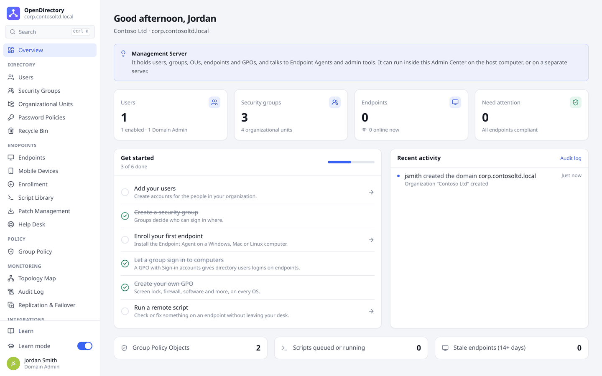
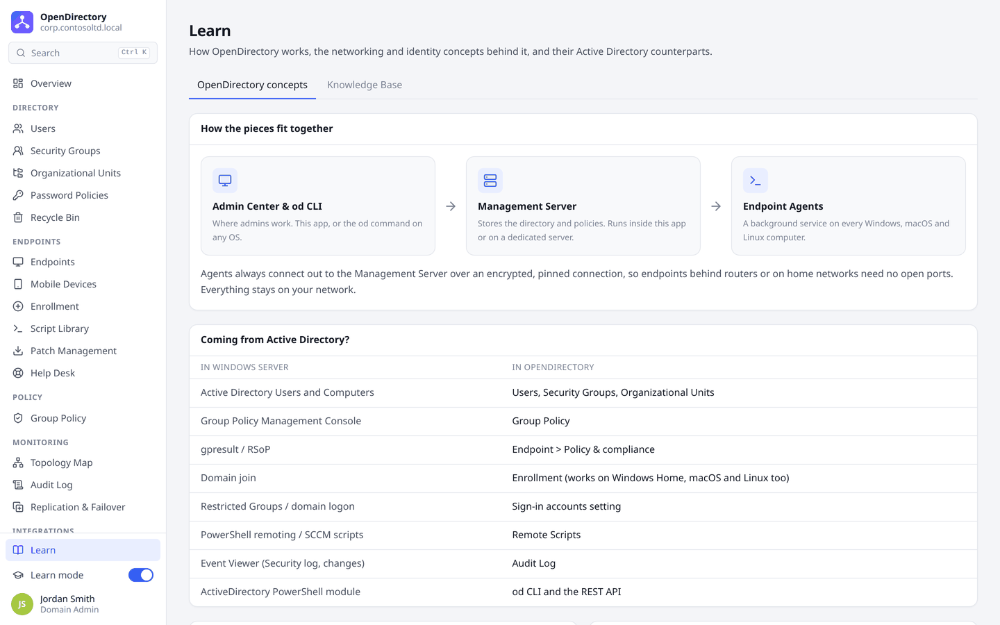

# 7. Walkthrough: install and create your domain

[Guide home](README.md) · Previous: [The person at the computer](06-end-user-experience.md) · Next: [Walkthrough: your first computer](08-walkthrough-first-endpoint.md)

This walkthrough takes you from nothing to a working directory, in about ten minutes. You'll use the simplest setup: the Admin Center and the Management Server on one computer.

**You'll need:**

- One computer to be your **Management Server**. It should stay on while you want your other computers managed. A desktop or an always-on laptop is fine for a home or small office.
- Windows 10 or 11, macOS, or a 64-bit Linux desktop.
- About ten minutes.

---

## Step 1: Install the Admin Center

1. Go to the [Download section of the README](../../README.md#download).
2. Click the button for your operating system:
   - **Windows:** the `.exe` installer.
   - **macOS:** the `.dmg`. Open it and drag OpenDirectory to Applications.
   - **Linux:** the `.deb` for Ubuntu, Debian or Mint, the `.rpm` for Fedora, or the AppImage for anything else.
3. Install it the usual way and open **OpenDirectory**.

The installers aren't code-signed yet, so your computer may warn you the first time. On Windows, click **More info** then **Run anyway**. On macOS, right-click the app, choose **Open**, then **Open** again.

## Step 2: Choose "Host the directory on this computer"

The first screen asks how you want to run OpenDirectory. Click **Host the directory on this computer**. This starts the Management Server inside the app.

(The other option, **Connect to an existing server**, is for when a Management Server already runs on another machine. You'd use it to manage that server from your own laptop.)

## Step 3: Name your organization



1. Type your **Organization name**, such as your company or family name.
2. Check the **Domain name** it suggests. You can keep the suggestion (it ends in `.local`, which is fine for private networks) or type your own, such as `corp.yourcompany.com` if you own `yourcompany.com`. Chapter 2 explains what the domain is.
3. Click **Continue**.

## Step 4: Create the first Domain Admin



This is **your** account. You'll use it to sign in to the Admin Center.

1. Enter your **Full name**. The **Username** fills itself in; change it if you like.
2. Choose a strong **Password** (at least 8 characters, longer is better) and type it again to confirm.
3. Write the username and password down somewhere safe, such as a password manager.
4. Click **Continue**.

> If you ever forget this password, the sign-in screen has a **Forgot password?** link. Your computer asks for its own administrator password, and then you can set a new one.

## Step 5: Choose a security baseline



A **security baseline** is a ready-made starting point: a set of OUs, groups and GPOs that suit a type of organization. It saves you from building everything from scratch, and you can change all of it afterwards.

| Baseline | Good for | What it sets up |
| --- | --- | --- |
| **Custom (blank)** | Experienced admins with a plan | Only the domain, the two built-in groups and your account |
| **Minimal** | Trying OpenDirectory out, or tracking hardware | A Computers OU and inventory. Nothing is enforced. |
| **Home / Homelab** | Families and tinkerers | Updates, firewall, a simple password policy. You stay an admin everywhere. |
| **Small Business** | Offices of 5 to 250 people | Staff, Workstations, Servers and IT OUs, password rules, screen lock, firewall, encryption checks, automatic updates |
| **Enterprise** | Bigger organizations with an IT team | Department and device OUs, tiered admin groups, patch rings with a pilot group, full auditing |
| **Education** | Schools and universities | Students, Faculty, Staff and Labs OUs, locked-down lab computers |
| **High Security** | Sensitive or regulated work | Long passwords, strict lockout, USB storage blocked, remote access off, full auditing |

Not sure? Click **Not sure? Answer three questions and we'll recommend one.** This guide uses **Small Business**, the most common choice. Click it, then **Continue**.

## Step 6: Customize it (optional)



This page lets you adjust the baseline: how strict the security level is, how updates are rolled out, who owns the devices, whether people are local admins, remote access, USB storage, and optional **compliance packs** for regulations such as HIPAA or GDPR.

Anything you leave on **Baseline default** follows the baseline. If you're unsure, leave everything as it is and click **Continue**.

## Step 7: Review and create



The review shows exactly what will be created. Nothing touches any other computer yet, because no computer is enrolled.

1. Leave **Launch at startup** on. It starts the Admin Center (and so your directory) automatically when you sign in to this computer, so it comes back after a restart.
2. Click **Create domain**.

## Step 8: Look around



You're in. The **Overview** page shows your counts and a **Get started** checklist. With the Small Business baseline you already have:

- four OUs: **Staff**, **Workstations**, **Servers** and **IT**,
- the **Staff** group, plus the built-in **Domain Admins** and **Domain Users**,
- two GPOs: **Default Endpoint Policy** (the security settings) and **Sign-in Accounts** (gives the Staff group accounts on computers).

Before moving on, switch on **Learn mode** at the bottom of the sidebar. Every technical term on screen then gets a short explanation, with its Active Directory name.



*The **Learn** page, also in the sidebar, has the full list of concepts and a "Coming from Active Directory?" table.*

---

**Next:** [enroll your first computer](08-walkthrough-first-endpoint.md).

<details>
<summary><b>Running the Management Server on a dedicated machine instead</b></summary>

If you'd rather keep the server on a machine that runs with nobody signed in (a small server, a mini PC, a virtual machine), install the Management Server as a service there:

```bash
sudo opendirectory-server install-service
```

Then, from that machine or any other, run the setup wizard in the terminal:

```bash
od init --server https://<server-address>:8443 --fingerprint <sha256>
```

Or use the Docker image ([docs/DOCKER.md](../DOCKER.md)), which also serves the Admin Center in a web browser. In the desktop Admin Center, choose **Connect to an existing server** and enter the server address and fingerprint shown when the server starts.

</details>
